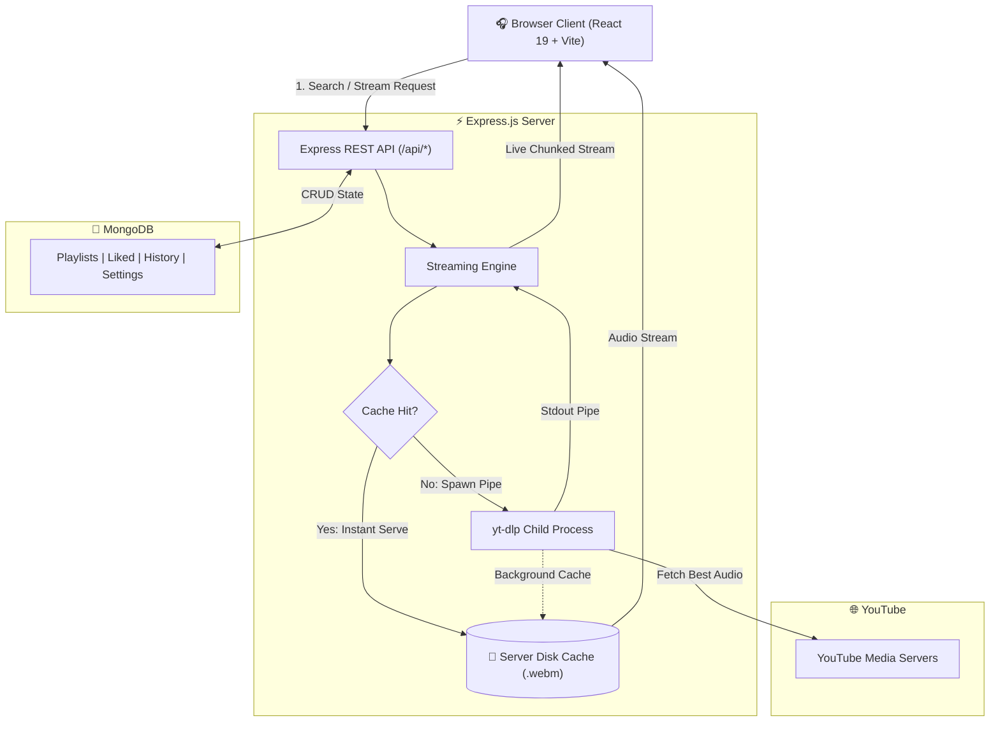

# 🎵 Survana V3 — The Ultimate Self-Hosted Music Sanctuary

<p align="center">
  
</p>

<p align="center">
  <b>A blazing-fast, ad-free, self-hosted music streaming and discovery platform.</b><br/>
  <i>Stream any track instantly, organize custom playlists, enjoy live audio visualizers, and cache music locally for offline listening.</i>
</p>

<p align="center">
  <a href="#-key-features"></a>
  <a href="https://react.dev/"></a>
  <a href="https://expressjs.com/"></a>
  <a href="https://www.mongodb.com/"></a>
  <a href="https://github.com/yt-dlp/yt-dlp"></a>
  <a href="#-docker-deployment"></a>
</p>

---

## 📖 Table of Contents
- [✨ Key Features](#-key-features)
- [🧠 How It Works (Deep Dive)](#-how-it-works-deep-dive)
  - [1. Search Pipeline](#1-search-pipeline)
  - [2. Stream Pipeline (Instant Piping)](#2-stream-pipeline-instant-piping)
  - [3. Dual-Tier Smart Caching](#3-dual-tier-smart-caching)
  - [4. Real-Time Audio Visualizer](#4-real-time-audio-visualizer)
  - [5. Database Architecture](#5-database-architecture)
- [🏗️ System Architecture](#️-system-architecture)
- [🚀 Quick Start Guide](#-quick-start-guide)
  - [Prerequisites](#prerequisites)
  - [Installation & Setup](#installation--setup)
  - [Environment Variables](#environment-variables)
  - [Starting the App](#starting-the-app)
- [🐳 Docker Deployment](#-docker-deployment)
- [🎧 User Walkthrough (How to Use Survana)](#-user-walkthrough-how-to-use-survana)
- [📡 API Reference](#-api-reference)
- [🛠️ Troubleshooting & FAQ](#️-troubleshooting--faq)
- [📜 License](#-license)

---

## ✨ Key Features

| Feature | Description |
| :--- | :--- |
| 🔥 **Fiery Glassmorphic UI** | Immersive crimson, orange, and charcoal aesthetic with dynamic glows, smooth transitions, and responsive navigation. |
| ⚡ **Instant Direct Streaming** | Low-latency audio streaming piped straight from `yt-dlp` to your browser without YouTube API keys, ads, or 403 Google Video blocks. |
| 💾 **Dual-Tier Cache** | **Server Cache** stores streamed tracks in `.webm` for instant re-play, while the **Client Offline Cache** uses the HTML5 File System Access API (`showDirectoryPicker`) to save tracks directly to your physical hard drive. |
| 🌌 **Real-Time Visualizer** | Interactive Web Audio API spectrum analyser with responsive frequencies, radial bass pulses, and dynamic color gradients. |
| 📚 **Complete Library Suite** | Create and manage custom playlists, save liked tracks, explore playback history, and track recently played music. |
| 🔒 **Privacy-First & Self-Hosted** | Zero user telemetry, no third-party tracking, fully isolated within your local network or VPS. |

---

## 🧠 How It Works (Deep Dive)

### 1. Search Pipeline
When you enter a search query:
1. The frontend hits `/api/search?q=<query>`.
2. The backend initiates a flat JSON search through `yt-dlp` (`ytsearch15:<query> --flat-playlist --dump-json`).
3. YouTube metadata (Title, Artist, Duration, High-Res Thumbnails, Video ID) is extracted and returned in milliseconds **without downloading any media**.

### 2. Stream Pipeline (Instant Piping)
Traditional YouTube frontends either hit Google Video rate limits or break with HTTP 403 Forbidden. Survana V3 solves this with an elegant two-stage streaming pipeline:
1. **Cache Check:** Express checks if the requested track (`<videoId> - <title>.webm`) is present in the cache directory. If found, it instantly serves it via `res.sendFile()`, supporting native range seeking and scrubbing.
2. **Direct Process Pipe:** If uncached, the backend spawns a lightweight `yt-dlp` process (`-f bestaudio -o -`) and pipes `child.stdout` directly into Express `res` as a chunked audio stream. The browser starts playing the audio buffer within seconds.
3. **Automatic Lifecycle Cleanup:** If you pause, skip to another song, or close the tab, the backend listens to `req.on('close')` and immediately terminates the worker process, avoiding CPU and bandwidth waste.
4. **Simultaneous Background Cache:** While you listen, the track is cached to disk in the background so future plays require zero external network requests.

### 3. Dual-Tier Smart Caching
Survana V3 provides offline listening both on the server and on your local client machine:
- **Server-Side Cache:** Managed via MongoDB settings (`/api/config/cache-path`). All tracks played are cached inside your configured directory.
- **Client Offline Storage (HTML5 File System Access API):** In the browser player, connect any local folder on your computer (e.g. `D:\Music`). Survana saves your downloaded tracks directly to that folder and uses IndexedDB to remember permissions. If offline, tracks load straight from your disk!

### 4. Real-Time Audio Visualizer
The built-in spectrum visualizer connects an `AudioContext` and `AnalyserNode` to the HTML5 `<audio>` element:
- Extracts fast-Fourier transform (FFT) frequency bins (`getByteFrequencyData`).
- Renders mirrored frequency bars dancing from the center outward on an HTML5 `<canvas>`.
- Features an animated pulsating radial core that responds dynamically to bass frequencies.

### 5. Database Architecture
Survana V3 utilizes **MongoDB** via Mongoose to store state cleanly:
- `Liked`: Songs marked as favorites by ID and metadata.
- `Playlist`: Custom user playlists with embedded song arrays.
- `History`: Play history automatically capped to the last 50 tracks to keep database footprints minimal.
- `Settings`: Dynamic server settings (e.g., custom cache directory paths).

---

## 🏗️ System Architecture



---

## 🚀 Quick Start Guide

### Prerequisites
Before running Survana V3, ensure you have:
- [Node.js](https://nodejs.org/) (v18 or higher)
- [Python 3](https://www.python.org/) (Python 3.10+) with `pip`
- [MongoDB](https://www.mongodb.com/try/download/community) running locally or a MongoDB Atlas connection string
- [yt-dlp](https://github.com/yt-dlp/yt-dlp):
  ```bash
  python -m pip install -U yt-dlp
  ```
- *(Optional but recommended)* [FFmpeg](https://ffmpeg.org/) installed and added to your system PATH.

---

### Installation & Setup

1. **Clone the repository:**
   ```bash
   git clone https://github.com/mayur0301/Survana-V3.git
   cd "Survana V3"
   ```

2. **Install all dependencies:**
   A root script installs dependencies for both `backend` and `frontend` in a single command:
   ```bash
   npm run install-all
   ```

3. **Configure Environment Variables:**
   Create a `.env` file in `backend/.env`:
   ```env
   PORT=5000
   NODE_ENV=development
   MONGODB_URI=mongodb://localhost:27017/survana-v3
   ```

4. **Start the Development Servers:**
   ```bash
   npm run dev
   ```
   This starts both servers concurrently:
   - **Frontend:** [http://localhost:5173](http://localhost:5173)
   - **Backend API:** [http://localhost:5000](http://localhost:5000)

---

## 🐳 Docker Deployment

For self-hosting on a home server, VPS, or NAS, Docker provides an isolated environment with Node, Python, and dependencies pre-configured:

1. **Build the Docker container:**
   ```bash
   docker build -t survana-v3 .
   ```

2. **Run with persistent storage:**
   ```bash
   docker run -d \
     -p 5000:5000 \
     -e MONGODB_URI=mongodb://host.docker.internal:27017/survana-v3 \
     -v survana-cache:/app/backend/cache \
     --name survana-instance \
     survana-v3
   ```

3. **Access Survana:**
   Open [http://localhost:5000](http://localhost:5000) in your browser.

---

## 🎧 User Walkthrough (How to Use Survana)

```
       ┌────────────────────────────────────────────────────────┐
       │   🔍  Search Bar: "Lofi Beats", "Hasan Raheem", etc.   │
       └────────────────────────────────────────────────────────┘
                                   │
         ┌─────────────────────────┴─────────────────────────┐
         ▼                                                   ▼
┌──────────────────┐                               ┌──────────────────┐
│  ▶ Instant Play  │                               │  ➕ Add to List   │
│  Streams audio   │                               │  Create custom   │
│  straight away   │                               │  playlists       │
└──────────────────┘                               └──────────────────┘
         │                                                   │
         ▼                                                   ▼
┌─────────────────────────────────────────────────────────────────────┐
│  🎵 Fixed Audio Player                                              │
│  • Play / Pause / Seek / Volume / Shuffle / Loop                   │
│  • 🌌 Visualizer Button: Switch to immersive full-screen spectrum   │
│  • ❤️ Like Button: Save track to Liked Songs collection            │
│  • 💾 Download: Save track directly to your local computer         │
└─────────────────────────────────────────────────────────────────────┘
```

1. **Search & Play:** Type any artist, track name, or playlist topic into the top search bar. Click any card to start streaming immediately.
2. **Like Songs:** Click the heart icon on any card or inside the audio player to save it to your **Liked Songs** page.
3. **Custom Playlists:** Create playlists from the sidebar, name them, and add tracks on the fly.
4. **Playback History:** Never lose a track you discovered. The **History** page retains your last 50 played tracks.
5. **Interactive Visualizer:** Click the spectrum icon in the player bar to open the live visualizer with pulsing bass rhythms.
6. **Local Folder Offline Mode:** In Settings, click **"Select Cache Folder"** and choose a local directory. Tracks you download will be saved directly to your hard drive.

---

## 📡 API Reference

### 🎵 Songs & Streaming
| Endpoint | Method | Description |
| :--- | :--- | :--- |
| `/api/search?q=:query` | `GET` | Searches YouTube via `yt-dlp` and returns metadata array. |
| `/api/stream/:id` | `GET` | Streams audio directly via `yt-dlp` or local cache; logs to history. |
| `/api/download/:id` | `GET` | Downloads audio to cache and triggers browser file download. |

### ❤️ Liked Songs
| Endpoint | Method | Description |
| :--- | :--- | :--- |
| `/api/liked` | `GET` | Returns array of user's liked tracks. |
| `/api/liked` | `POST` | Adds song `{ id, title, artist, duration, thumbnail }` to favorites. |
| `/api/liked/:id` | `DELETE` | Removes song from favorites. |

### 📁 Playlists
| Endpoint | Method | Description |
| :--- | :--- | :--- |
| `/api/playlists` | `GET` | Lists all playlists. |
| `/api/playlists` | `POST` | Creates a new playlist `{ name, description }`. |
| `/api/playlists/:id` | `GET` | Gets playlist details and song array. |
| `/api/playlists/:id/songs` | `POST` | Adds track to playlist. |
| `/api/playlists/:id/songs/:songId` | `DELETE` | Removes track from playlist. |
| `/api/playlists/:id` | `DELETE` | Deletes playlist. |

### 🕒 History & Configuration
| Endpoint | Method | Description |
| :--- | :--- | :--- |
| `/api/history` | `GET` | Returns recent playback history (capped at 50). |
| `/api/history` | `DELETE` | Clears all history records. |
| `/api/config/cache-path` | `GET` | Retrieves active server cache directory path. |
| `/api/config/cache-path` | `POST` | Updates cache directory `{ path: "..." }`. |

---

## 🛠️ Troubleshooting & FAQ

<details>
<summary><b>1. What should I do if streaming gives an error?</b></summary>
<br/>
Ensure that <code>yt-dlp</code> is updated to the latest version by running:

```bash
python -m pip install -U yt-dlp
```
YouTube frequently updates its video delivery formats, and running the latest `yt-dlp` version ensures unbroken playback.
</details>

<details>
<summary><b>2. Do I need YouTube API Keys or cookies?</b></summary>
<br/>
<b>No!</b> Survana V3 requires zero Google/YouTube API keys and does not require cookies. Audio is streamed directly via <code>yt-dlp</code> stdout without hitting quota limits or authentication barriers.
</details>

<details>
<summary><b>3. Why is MongoDB required?</b></summary>
<br/>
MongoDB stores your playlists, liked songs, history, and custom settings. You can run MongoDB locally (<code>mongod</code>), run it in a Docker container, or use a free <a href="https://www.mongodb.com/atlas">MongoDB Atlas</a> cloud cluster.
</details>

<details>
<summary><b>4. Is FFmpeg mandatory?</b></summary>
<br/>
FFmpeg is optional for playback because Survana streams native Opus/WebM audio tracks directly. However, having FFmpeg installed on your system PATH is recommended if you wish to convert downloaded tracks to other formats.
</details>

---

## 📜 License

This project is licensed under the **ISC License**. Feel free to customize, host, and enjoy!

<p align="center">
  <b>Designed with ❤️ for self-hosters and audiophiles.</b><br/>
  <i>Happy Listening! 🎧</i>
</p>
