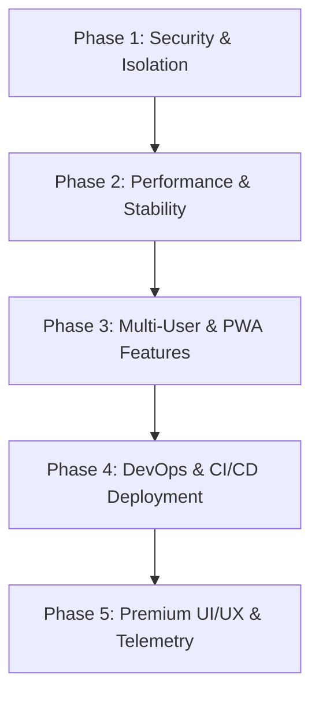

# Survana V3 - Enterprise-Grade Development Roadmap

This roadmap outlines a 5-phase engineering plan to transform Survana V3 from a local single-user music player into an optimized, secure, multi-tenant streaming platform.

---

## Roadmap Phases

### 1. [Phase 1: Security Hardening & Input Sanitization](file:///c:/Users/Vaibhav/OneDrive/Desktop/Survana%20V3/docs/phase1-security.md)
*Focus: Vulnerability patching, request isolation, and filesystem safety.*
- [ ] Strict path whitelisting for cache locations
- [ ] Server configuration endpoint protection
- [ ] API Rate Limiting (express-rate-limit)
- [ ] Schema validation (Zod/Joi) for all inputs
- [ ] Secure CORS, Helmet Content-Security Policies (CSP), and XSS prevention

### 2. [Phase 2: Resource Management & Bug Fixes](file:///c:/Users/Vaibhav/OneDrive/Desktop/Survana%20V3/docs/phase2-bugfixes.md)
*Focus: Scaling system resource usage, decreasing latencies, and system cleanups.*
- [ ] Process Concurrency Queue (throttling active `yt-dlp` spawns)
- [ ] In-Memory & Database-backed Search Caching (LRU)
- [ ] Non-blocking asynchronous Cache Migration on startup
- [ ] React 19 warning resolutions & Error Boundaries for Canvas Visualizer
- [ ] Alignment of Tailwind CSS color nomenclature variables

### 3. [Phase 3: Enterprise scaling & Multi-User Features](file:///c:/Users/Vaibhav/OneDrive/Desktop/Survana%20V3/docs/phase3-features.md)
*Focus: Transitioning to multi-tenant environments and client-side playback portability.*
- [ ] Multi-User accounts & JWT-based Session Authentication
- [ ] Service Worker & Cache Storage API for Browser Offline Playback (PWA)
- [ ] On-the-fly media compression and adaptive transcoding (FFmpeg)
- [ ] Disk quota monitoring and auto-cleanup cron jobs

### 4. [Phase 4: DevOps, CI/CD, and Production Deployments](file:///c:/Users/Vaibhav/OneDrive/Desktop/Survana%20V3/docs/phase4-deployment.md)
*Focus: Automated deployment pipelines, server optimization, and SSL.*
- [ ] Nginx reverse proxy configuration (with caching and Gzip enabled)
- [ ] Docker container optimization (running as a non-root `node` user)
- [ ] Automated CI/CD pipelines (GitHub Actions) for build checks and deployment
- [ ] Render / AWS ECS / PM2 deployment configuration and process monitoring
- [ ] Let's Encrypt SSL configuration

### 5. [Phase 5: Advanced UI/UX & Diagnostics telemetry](file:///c:/Users/Vaibhav/OneDrive/Desktop/Survana%20V3/docs/phase5-ux-analytics.md)
*Focus: Premium customer experience enhancements and runtime visibility.*
- [ ] Synchronized LRC lyrics parser and karaoke UI overlay
- [ ] Playback state and active queue local storage persistence
- [ ] Custom themes (Glassmorphism, Neon Cyberpunk, OLED dark mode toggler)
- [ ] Centralized Logging (Winston) and server performance dashboard metrics
